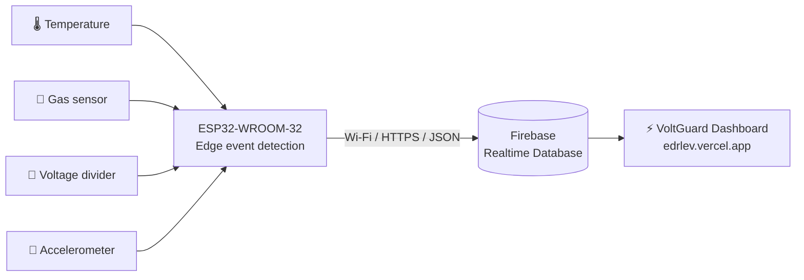

# 🔋 Event Data Recorder for Light Electric Vehicles

### IoT-Based Real-Time Monitoring & Event Recording System using ESP32, Firebase & the VoltGuard Dashboard

[](https://edrlev.vercel.app)


A low-cost ESP32 prototype that monitors temperature, gas, voltage and acceleration in real time, detects critical events on-device, pushes readings to the cloud, and lays the groundwork for a **forensic-grade Event Data Recorder (EDR)** for LEV battery packs.

🔗 **Live dashboard:** [edrlev.vercel.app](https://edrlev.vercel.app)

[Overview](#-overview) •
[Phase 2 – VoltGuard](#-phase-2--voltguard-current-version) •
[Architecture](#️-system-architecture) •
[Hardware](#-hardware-components) •
[Getting Started](#-getting-started) •
[Results](#-performance-metrics) •
[Roadmap](#-future-work)

---

## 📖 Overview

Investigations into lithium-ion battery thermal runaway incidents in real-world LEV (electric two-wheeler) fleets consistently show that onboard BMS and telematics hardware is destroyed once thermal runaway propagates — resulting in **total loss of volatile event logs**. Existing solutions (gas-sensor research, patented cable-based detection circuits, commercial BMS/telematics) focus almost entirely on *prevention* and *local alerting*, with no mechanism to preserve forensic data during propagation.

This project is a step toward closing that gap: a low-cost prototype that

- ⚡ Continuously monitors **temperature, gas concentration, voltage and acceleration**
- 🚨 Applies **threshold-based anomaly detection** with persistence filtering
- 💥 Detects **impact and free-fall** events (Phase 2)
- ☁️ Immediately pushes sensor data and alert states to **Firebase**, so data "escapes" the device before hardware compromise
- 🖥️ Provides both **local (LCD + buzzer)** and **remote (VoltGuard web dashboard)** visibility

> ⚠️ This is a student research prototype, **not a certified automotive safety system**.

---

## 🗺️ Project Evolution

| Phase | Course | What was built |
|---|---|---|
| **Phase 1** | Embedded Systems (BCSE305L), Winter 2025–26 | Breadboard prototype: temperature, gas, voltage, 16×2 LCD, buzzer, Firebase upload |
| **Phase 2** (current) | Project-I (BCSE497J), Fall 2026–27 | Accelerometer for impact/free-fall, persistence filtering, live/history/events data model, VoltGuard dashboard |

---

## 🆕 Phase 2 – VoltGuard (Current Version)

### What's new

- 📐 **Accelerometer / gyroscope** added for impact and free-fall detection
- 🧹 **Persistence filters**: a condition must hold for several consecutive samples before it becomes an event, which cuts false alerts
- 🗂️ **Three-level Firebase data model**: live, history and a permanent event log
- 🖥️ **VoltGuard dashboard** deployed at [edrlev.vercel.app](https://edrlev.vercel.app)

### Phase 2 architecture



### Firebase data model

```
edr/
└── edr01/                 ← device ID
    ├── live               ← overwritten ~every 5 s
    ├── history/           ← new record ~every 60 s + every critical reading
    └── events/            ← one record per critical event
```

| Field | Meaning |
|---|---|
| `ts` | Firebase server timestamp (ms) |
| `uptime_ms` | Time since the ESP32 booted |
| `state` | `NORMAL` or `CRITICAL` (decided on-device) |
| `temp_c` | Temperature in °C |
| `gas` | Raw 12-bit ADC reading (0–4095), **not ppm** |
| `volt_v` | Measured voltage in V |
| `acc_g` | Acceleration magnitude in g |
| `gyro` | Motion state: `MOVING`, `STILL` or `--` |
| `event_no` | Event counter (events only) |

### Phase 2 event thresholds

| Parameter | Critical condition |
|---|---|
| 🌡️ Temperature | ≥ **45 °C** |
| 💨 Gas (ADC) | ≥ **3000** |
| 🔋 Under-voltage | < **10.5 V** (only when a voltage ≥ 1.0 V is present) |
| 🔋 Over-voltage | > **14.8 V** |
| 💥 Impact | ≥ **2.5 g** |
| 🪂 Free-fall | ≤ **0.30 g** |

> **Note:** the firmware has a `SIMULATE_IDLE_VOLTAGE` flag for bench testing without a battery attached. Set it to `false` for real measurements.

### 🖥️ VoltGuard Dashboard

| Section | What it shows |
|---|---|
| **Live sensor readings** | Temperature, gas ADC, voltage, acceleration, with threshold indicators |
| **Analytics** | Historical line chart for each metric (latest 120 records, last 60 points plotted) |
| **Device health** | Online/offline (offline if data is > 20 s old), motion state, uptime |
| **Critical event log** | The 30 most recent CRITICAL events with full sensor snapshot |
| **Export / Demo** | CSV download; clearly labelled demo mode with simulated data for presentations |

Built with plain HTML/CSS/JavaScript, the Firebase Web SDK and Chart.js, and deployed on Vercel. Source is in [`dashboard/`](dashboard/).

---

## 🏗️ System Architecture

> The sections from here to **Comparative Analysis** describe the **Phase 1** prototype. For the current version, see [Phase 2](#-phase-2--voltguard-current-version) above.

```
Sensors → ESP32 (ADC + Processing) → WiFi (TCP/IP, JSON) → Firebase Realtime Database → Web Dashboard / Mobile UI
```

| Layer | Function |
|---|---|
| **Sensing** | Temperature, gas, and voltage sensors generate analog/digital signals |
| **Processing** | ESP32 samples via ADC, applies filtering and threshold logic |
| **Communication** | Data serialized to JSON, transmitted over WiFi via HTTP/REST |
| **Cloud** | Firebase Realtime Database stores and syncs data instantly |
| **User Interface** | Web dashboard / LCD displays live values and alerts |

The system runs as a **soft real-time**, polling-based loop (no RTOS/interrupts): `Read → Process → Transmit → Display`, repeating every ~2 seconds.

<details>
<summary><b>Finite State Machine</b></summary>

```
Idle → Read Sensors → Send Data (Firebase) → Display Output → (loop)
```
- **Idle:** system waits for the next cycle
- **Read:** acquires temperature, gas, voltage
- **Send:** transmits JSON payload to Firebase
- **Display:** updates LCD and web UI

</details>

---

## 🔧 Hardware Components

| Component | Model | ESP32 Pin | Interface | Role |
|---|---|---|---|---|
| Microcontroller | ESP32 DevKit | — | WiFi + GPIO | Central processing & communication |
| Temperature Sensor | DS18B20 | GPIO4 | OneWire (Digital) | Temperature acquisition |
| Gas Sensor | MQ-x series | GPIO34 | Analog (ADC) | Gas concentration / off-gassing detection |
| Voltage Sensor | Voltage divider module | GPIO35 | Analog (ADC) | Supply voltage monitoring |
| Display | 16×2 LCD (I2C) | GPIO21 (SDA), GPIO22 (SCL) | I2C | Local real-time readout |
| Buzzer | Piezo buzzer | GPIO25 | Digital output | Audible alert |
| Power | 3.7V 18650 Li-ion / USB | 3.3V / 5V | — | System power |
| Accelerometer / Gyro *(Phase 2)* | IMU module | I2C | I2C | Impact and free-fall detection |

> Phase 1 was built entirely on a solderless breadboard — no soldering, no real battery pack, no thermal runaway testing at this prototype stage.

📄 See [Block diagram](Block%20diagram.pdf) and [Hardware cost](Final%20Updated%20Hardware%20Cost%20.pdf).

---

## ⚙️ Software Stack

| Category | Details |
|---|---|
| Framework | Arduino core for ESP32 (Arduino IDE / PlatformIO) |
| Libraries | `WiFi.h`, `OneWire.h`, `DallasTemperature.h`, `LiquidCrystal_I2C.h`, Firebase ESP32 Client, `ArduinoJson` |
| Cloud Backend | Firebase Realtime Database (JSON store, REST + WebSocket sync) |
| Protocol | HTTP/REST over WiFi (TCP/IP), JSON payloads |
| Dashboard *(Phase 2)* | HTML, CSS, JavaScript, Firebase Web SDK, Chart.js — hosted on Vercel |

**Sample Firebase document (Phase 1):**

```json
{
  "temperature": 28.3,
  "gas": 118,
  "voltage": 3.91,
  "status": "NORMAL"
}
```

---

## 🧠 Algorithm

```
1. Initialize sensors, WiFi, and Firebase connection
2. Read temperature, gas, and voltage values
3. Convert raw ADC values into usable units
4. Compare readings against predefined thresholds
5. Set system status to NORMAL or ALERT
6. Activate buzzer/LED if an alert condition is detected
7. Push data to Firebase in JSON format
8. Update LCD / web UI
9. Repeat continuously (~2 second cycle)
```

**Alert thresholds (Phase 1):**

| Parameter | Normal Range | Alert Condition |
|---|---|---|
| Temperature | 20–50 °C | > 60 °C |
| Gas | 100–250 ppm | > 300 ppm |
| Voltage | 3.7–4.2 V | < 3.3 V |

---

## 🌐 Execution Model (Edge / Fog / Cloud)

| Layer | Platform | Function |
|---|---|---|
| **Edge** | ESP32 | Sensor reading, local threshold checks, alert generation |
| **Fog** | Local WiFi network | Buffering, LCD/local display |
| **Cloud** | Firebase | Long-term storage, remote monitoring, dashboard sync |

---

## 📊 Performance Metrics

| Metric | Measured | Target |
|---|---|---|
| Response Time | 1–2 s | < 3 s |
| Sampling Interval | 2 s | 2 s |
| Detection Accuracy | ~95% | ≥ 90% |
| Data Transmission Success | ~90% | ≥ 85% |
| System Uptime | ~99% | ≥ 95% |
| False Alerts | < 5% | < 10% |

<details>
<summary><b>✅ Test Case Summary</b></summary>

| TC# | Scenario | Expected Result | Status |
|---|---|---|---|
| TC01 | Normal operation | Status = NORMAL | ✅ PASS |
| TC02 | Gas > threshold | ALERT, buzzer ON | ✅ PASS |
| TC03 | Temperature > threshold | ALERT triggered | ✅ PASS |
| TC04 | Voltage drop | ALERT, warning shown | ✅ PASS |
| TC05 | WiFi disconnection | Data buffered, retry | ✅ PASS |
| TC06 | WiFi reconnect | Transmission resumes | ✅ PASS |
| TC07 | Continuous long-duration run | No crash, stable | ✅ PASS |
| TC08 | Display accuracy check | LCD matches sensor values | ✅ PASS |

</details>

---

## 📈 Comparative Analysis

| Feature | This Project (ESP32) | Arduino | Raspberry Pi | Commercial System |
|---|---|---|---|---|
| Cost | Low | Low | High | Very High |
| WiFi | Built-in | External module | Built-in | Built-in |
| Power Consumption | Low | Moderate | High | Optimized |
| Real-time Response | Fast | Moderate | Slower | Fast |
| Scalability | Good | Limited | High | High |
| Ease of Use | Simple | Moderate | Complex | Professional |

---

## 📂 Repository Structure

```
├── dashboard/                              # VoltGuard web app (Phase 2)
│   ├── index.html
│   ├── styles.css
│   ├── app.js
│   └── firebase.json
├── Block diagram.pdf                       # System block diagram
├── Final Updated Hardware Cost .pdf        # Bill of materials
├── Code for Local Website or Blynk cloud   # Phase 1 code (local website / Blynk)
└── README.md
```

---

## 🚀 Getting Started

### Prerequisites
- ESP32 development board
- DS18B20 temperature sensor, MQ-x gas sensor, voltage divider module, accelerometer/gyro module
- 16×2 I2C LCD, piezo buzzer, breadboard, jumper wires
- Arduino IDE or PlatformIO
- A Firebase project with Realtime Database enabled

### Installation

```bash
# 1. Clone the repository
git clone https://github.com/Hrishikesh-sinha/Event---Data---Recorder-For---Light-Electric-vehicle-.git
cd Event---Data---Recorder-For---Light-Electric-vehicle-
```

1. Open the firmware project in Arduino IDE / PlatformIO.
2. Install required libraries: `WiFi.h`, `DallasTemperature.h`, `OneWire.h`, `LiquidCrystal_I2C.h`, Firebase ESP32 Client, `ArduinoJson`.
3. Update WiFi SSID/password and Firebase credentials (Database URL + Auth) in the firmware config section. **Never commit real credentials.**
4. Wire the components according to the [pin table](#-hardware-components) above.
5. Flash the firmware to the ESP32 and open Serial Monitor to verify sensor readings.
6. Open the web dashboard (or Firebase console) to view live data.

### Firebase setup (Phase 2)

1. In the Firebase console, go to **Authentication → Sign-in method** and enable **Anonymous**.
2. Use path-restricted Realtime Database rules (development example only):

```json
{
  "rules": {
    "edr": {
      "edr01": {
        ".read": "auth != null",
        ".write": "auth != null"
      }
    }
  }
}
```

> 🔒 Fine for a demo but **not for production**: any anonymous user could write. A real deployment needs a per-device identity and least-privilege rules.

### Running the VoltGuard dashboard locally

```bash
cd dashboard
python3 -m http.server 5500     # Windows: py -m http.server 5500
# open http://localhost:5500
```

Do not open `index.html` via `file://`. To deploy, use Vercel, Netlify or `firebase deploy --only hosting`, and add the deployed domain to **Firebase Auth → Authorized domains**.

---

## 🔭 Future Work

- [x] Remote web dashboard with live data, history charts and event log *(VoltGuard, Phase 2)*
- [x] Impact and free-fall detection with an accelerometer *(Phase 2)*
- [ ] Ultra-early precursor detection (off-gassing signatures) for earlier warning lead time
- [ ] Independent power buffering / thermal hardening for hardware survival during propagation
- [ ] Local SD/flash ring buffer so data survives a Wi-Fi outage
- [ ] Multi-sensor fusion (gas + impedance + pressure + acoustic) to reduce false positives
- [ ] Wireless burst transmission via ESP8266/ESP32 as add-on module for forensic payload escape
- [ ] Per-device authentication and secure Firebase rules
- [ ] Field validation under real-world LEV operating conditions

---

## 👥 Contributors

| Name | Reg. No. | 
|---|---|---|
| Hrishikesh Anand | 


School of Computer Science and Engineering, VIT University, Vellore, India

## 🔗 Links

- 🌐 **Live Dashboard:** [edrlev.vercel.app](https://edrlev.vercel.app)
- 📁 **Project Drive:** [Google Drive folder](https://drive.google.com/drive/folders/19CHtPH2I57WzOcKTYWXAbDedC10_Tpc5?usp=sharing)

## 📄 Course

- **Phase 1:** Embedded Systems (BCSE305L), Winter Semester 2025–26, Vellore Institute of Technology
- **Phase 2:** Project-I (BCSE497J), Fall Semester 2026–27, Vellore Institute of Technology

## 📜 License

Released under the [MIT License](LICENSE).

Made with ⚡ at VIT University
